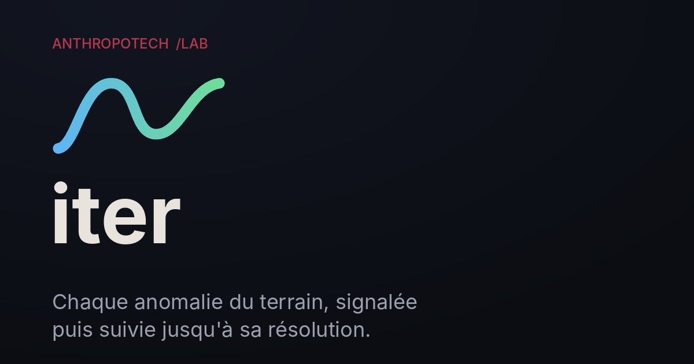

# iter, page de présentation

**Chaque anomalie du terrain, signalée puis suivie jusqu'à sa résolution.**

Un trottoir abîmé, une branche dangereuse, un panneau tombé : aujourd'hui, ces informations circulent par un appel, un message, un papier oublié. iter les rassemble sur une seule carte, avec une position précise, une photo et un statut pour chacune.

Ce dépôt contient la page de présentation d'iter, destinée aux élus et à la direction.

  
  

## Ce que présente la page

| Rubrique | Contenu |
|:--|:--|
| Repérer | Le périmètre de la commune sur la carte, chaque signalement à sa position exacte |
| Documenter | L'agent signale à sa position GPS, avec une précision et une photo |
| Suivre | Le poste de supervision : priorités, statuts, export CSV |
| Organiser | Une taxonomie à deux niveaux (16 catégories, 132 sous-catégories), ajustée par la commune |
| Piloter | Évolution, répartition par catégorie, délais réels, export PDF |
| Sécuriser | Droits imposés par la base de données, photos dans un espace privé, comptes nominatifs, journal d'activité |

## Principes

- Aucun cookie, aucun traceur, aucune publicité.
- Aucune ressource chargée depuis un service tiers.
- Page non référencée par les moteurs de recherche.

## Technique

Page statique en HTML, CSS et JavaScript, sans dépendance, hébergée sur GitHub Pages.

---

iter, projet N°07 d'Anthropotech Lab. Conçu et développé par Shams &amp; Dean. 
© 2026 Shams Guettaf, Anthropotech Lab. Tous droits réservés. Voir <a href="LICENSE">LICENSE</a> et les <a href="https://shamsetdean.github.io/iter-presentation/mentions-legales.html">mentions légales</a>.
